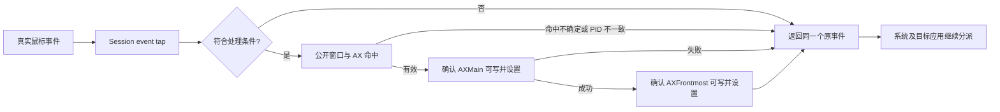

# Phase 2：A4 架构决策

日期：2026-10-15，Asia/Makassar。主线：首次点击执行原操作，允许正常激活和窗口前移。目标 macOS 27；Swift 6、AppKit、SwiftUI，不支持旧系统。

平台政策后续更新：用户已将最低部署目标改为 macOS 14，见 [平台 Agent Note](../../.agents/notes/implemented/architecture/2026-10-15-macos14-platform.md)。本文的 27 版本描述保留原批准背景；A4 调用顺序与事件约束继续有效。

本文件根据已完成的 PoC 选择主路径，定义正式实现边界，供进入 Phase 3 前评审。本轮没有修改或重新构建 A4，没有新增实机试次；架构选择不等于所有应用、手势、工具兼容和性能均已验证。

## 1. 决策摘要

| Phase 2 问题 | 决策 |
| --- | --- |
| 核心系统 API | `CGEvent.tapCreate` + 公开窗口命中／owner PID + 窗口 `AXMain` + 应用 `AXFrontmost`。保持 A4 的顺序，最后返回同一个原事件。 |
| 是否需要混合执行策略 | 当前不需要。正式主路径不混入 AXPress、普通 activate、鼠标重放或 PID 定向投递，也不在失败时自动尝试其他路线。 |
| 是否需要鼠标事件状态机 | 不需要吞下、缓存、重放手势的状态机。up/drag 不参与激活，原样通过。只需要引擎启停、权限与故障的生命周期状态机。 |
| 是否需要个别应用兼容模式 | 当前不预置应用白名单、应用专用复制逻辑或特殊模式。目标必须由公共命中与动态 AX 能力确定；明确问题再按机制处理。 |
| 已知系统限制 | AX 调用可失败或部分完成，成功不是同步激活屏障；目标应用仍决定如何处理事件。系统可停用 tap，未验证范围必须明确保留。 |
| 不 raise 选项 | 用户已要求暂停；仅保存为未来探索，不进入本次架构、配置界面或自动回退链。 |

## 2. 为什么选择 A4

现有证据已经足够选择主路径，不再以补齐软件名单为进入 Phase 2 的条件。

| 证据 | 对决策的意义 | 保留边界 |
| --- | --- | --- |
| A1/A2 从 Codex 切到原生拒绝 first mouse 靶标仍失败；A2 在同应用 Chrome 条件有改善 | 仅普通应用激活不能覆盖已观察的两类窗口条件 | 不把 API 返回 true 当作业务成功 |
| A3 的跨应用改善与同应用后台 Chrome 窗口空缺 | 仅应用前台属性不足；不能因目标 PID 已在前台便跳过另一个窗口 | AXMain 也不能独自证明 key focus |
| A4：Chrome 两种来源的按钮各 +1、输入可用；原生单击、拖出取消、菜单有局部回归 | 窗口步骤与应用步骤的组合具有实际业务依据 | 一部分输入结果来自用户反馈，不能扩大为所有控件和拖动 |
| A4：真实 ChatGPT 网页复制有效匹配；停止对照有效不匹配 | 首次点击确实能完成业务，而不只是获得焦点 | 一组标注对照，不是统计可靠性证明 |
| Safari 用户实测正常，跨应用按钮及右键有日志；同时存在 AX 查询／读回错误 | 继续沿通用路径实现，但保留错误观测和原事件通过能力 | 不设置 Safari 白名单或静默重试以掩盖错误 |

详细依据见 [Phase 1 结论](../research/PHASE_1_RESULTS.md)、[A4 窗口评估](../research/WINDOW_FOCUS_ADDENDUM.md) 及其中的独立原始日志。

替代路线的取舍：AXPress 能执行部分后台按钮，但真实网页复制已失败，且不保留完整鼠标语义；重放会引入手势配对和重复操作问题，当前没有必要；PID 投递仍无本机业务验证。都不作为隐式备选。未来出现具体、无法由 A4 路径解释的故障时，再独立评估候选。

## 3. 点击路径与不可改变的约束

调用基线对应 [Probe.swift:150](../../poc/activation-preserve/Probe.swift#L150)、[窗口步骤:212](../../poc/activation-preserve/Probe.swift#L212)、[应用步骤:236](../../poc/activation-preserve/Probe.swift#L236)、[A4 分支:294](../../poc/activation-preserve/Probe.swift#L294)。

1. 使用 session、head-insert、主动 tap；主动类型是为了在同步回调里先请求激活，不意味着吞掉真实点击。只处理真实左右 down；普通 up/drag 不再请求激活。
2. 使用 `NSWindow.windowNumber(at:belowWindowWithWindowNumber:)` 与 CGWindow 元数据确定可命中窗口及 owner PID；用 AX 命中元素的 `AXWindow` 取得公开窗口对象。PID 不一致、窗口关联失败、非普通窗口层或自身控制窗口均放行。
3. 先动态确认并写入窗口 AXMain。只有 setter 明确成功才进入应用 AXFrontmost 步骤。任何失败都返回原事件；不补点、不排队等待、不回退普通 activate。
4. 不按“应用已在前台”跳过窗口步骤，保留同应用非 key 窗口能力。也不在缺少可靠窗口状态依据时加入“已经激活”的优化缓存。
5. 不创建鼠标事件、不重新投递、不修改坐标、时间戳、click count、flags 或来源。双击保留系统原始序列；拖出取消交给目标控件处理，不添加 debounce 或人工合并点击。
6. 首次正式迁移保持已验证调用顺序，包括现有的一次 AXFrontmost 即时读回。它仅为诊断，不是完成屏障；在没有新证据前，不将移除读回、异步化激活或换 tap 阶段与迁移捆绑。
7. 保留现有 25 ms 消息超时调用：system-wide AX 对象设置本进程全局默认超时，随后对窗口和应用对象显式覆盖为同值。它不是整段回调的硬上限；不能据此宣称端到端延迟小于 25 ms。此处按 Apple 文档补全语义，未改变源码调用。总耗时优化与主路径正确性分开评价。

## 4. 执行上下文与组件边界

首版采用一个原生进程，不增加守护进程、XPC helper、驱动或外部依赖。

| 组件 | 责任 | 不能承担的工作 |
| --- | --- | --- |
| App 状态与 SwiftUI 菜单／设置 | 展示开启、停止、权限缺失、系统暂停；接收用户开关 | 不根据窗口获得焦点显示“点击成功”，不把研究模式 A1/A2/A3 暴露为产品必选项 |
| EventTapEngine | 创建、移除 tap；接收事件并返回同一个事件；发布简洁状态 | 不重放、不缓存手势、不用异步任务在原事件放行之后补激活 |
| WindowResolver | 屏幕坐标转换、公开窗口命中、层级／PID 校验、AXWindow 关联 | 不用私有窗口 ID 关联，不根据窗口矩形猜测被遮挡按钮 |
| A4Activation | 按固定顺序执行窗口与应用 AX 步骤，输出结构化结果 | 不读业务按钮名称、不操作剪贴板、不做自动多方案尝试 |
| Diagnostics | 生命周期、失败原因与有限耗时记录；调试时保留必要事件字段 | 不保存键盘输入、剪贴板、网页正文或窗口标题，不在拖动中持续刷新 UI |

输入回调首版沿用 A4 的主 RunLoop 同步执行上下文，AppKit 调用保持 MainActor 隔离；CGEvent 不跨异步边界。日志写入可以异步，激活步骤不能仅为避免阻塞而挪到事件返回之后。将整个输入路径搬到专用线程会改变 AppKit 命中与时序假设，留作有实际耗时证据后的独立优化，不作为本次迁移前提。

生命周期和 UI 状态使用强类型表示；AX 错误、属性不支持、属性不可写分别记录，修正 PoC 中把查询错误统称 `frontmost_not_writable` 的诊断歧义。这是错误表达的改进，不改变遇到错误就放行的原则。

## 5. 权限、故障与恢复

| 状态 | 行为与转换 |
| --- | --- |
| 停止 | 没有活动 tap；用户开启后检查信任与创建结果 |
| 需要授权 | 提供清楚的系统设置入口；授权后由用户再次开启，不循环弹窗 |
| 运行 | 仅在已确定的边界内发出 A4 请求，其他事件照常通过 |
| 系统暂停 | 收到 tap disabled、权限失效或创建失败时停用并释放资源，菜单展示原因；用户点击恢复后重新检查并创建 |
| 退出 | 移除 tap 和 RunLoop source、保存必要状态、结束进程；不保留拦截后台服务 |

单次 AX 命中或写入失败不会吞掉点击，也不会尝试别的执行策略。AXMain 已成功而应用步骤失败时可能存在部分状态变化，不能承诺事务回滚或恢复原窗口顺序。API 不可写、消息失败、目标已退出等按实际错误保留，不能由一个错误码推出整个应用永久不支持。

本路径依赖辅助功能信任与实际 event tap 能力。Listen/Post preflight 只作为诊断：现有 AX 可信、tap 可用而部分 preflight 为 false 的事实，不能被 UI 误报成“必须再开全部权限”。没有鼠标投递路径，不主动请求投递权限；不为窗口元数据或诊断请求屏幕录制。

固定应用 bundle ID、稳定构建位置与签名身份是实现约束，避免重复生成同名不同身份的授权项。开发阶段若只有 ad-hoc 签名，应明确重建可能需要重新授权；不能保证换二进制后 TCC 一定保持。正式分发按 Developer ID、Hardened Runtime 与公证准备，跨应用 AX 不以 App Sandbox 或私有 entitlement 作为前提；本轮不操作证书或分发。

## 6. 鼠标语义与工具共存

| 输入／环境 | 首版架构行为 | 当前证据边界 |
| --- | --- | --- |
| 无键盘修饰的左右单击 | 保持 A4 两类 down 的处理链；右键不改为 AXShowMenu | 已测右键主要证明保持基线能力，不是普遍改善 |
| 双击及连续点击 | click count、时间戳及每次 down/up 原样通过，不延迟聚合、不去重 | 已有按钮两次操作；不等于文本双击、三击全面通过 |
| 拖动 | 仅初始 down 可能执行 A4；后续 drag/up 原样通过 | 原生取消／恢复有证据；文本、文件、对象拖动未全面验证 |
| Cmd/Shift/Option/Control/Fn 等修饰点击 | 初次迁移保留现有键盘修饰标志过滤，原样放行；不剥离或添加 flags | 保留系统及重映射语义；未承诺带修饰键的首次点击均被增强。Caps Lock 等状态标志的政策也不在迁移时悄悄更改 |
| yabai / skhd / Karabiner-Elements | 不改工具配置，不截获键盘，不消费保留给其他工具的修饰点击，不重投进其他 tap | 已有同时运行观察；专用移动／缩放和快捷键兼容仍未完成，不能宣称全部通过 |
| 菜单、弹出层、特殊窗口 | 非普通层不主动激活，不尝试穿透菜单或查找下面的业务按钮 | 原生菜单选项 layer 101 的放行已有局部依据 |

本阶段不为个别应用添加业务适配、缓存例外或自动兼容模式。当前控制手段是全局关闭／恢复；未来只有出现明确故障与用户需求时，才评估最小的排除选项或通用机制调整。

## 7. 产品范围与后续实施顺序

首个正式版本包含原生菜单栏入口、开启／停止、权限说明、恢复入口、简洁设置与可关闭的诊断记录。界面显示“已开启／已停止／需要授权／已暂停”等用户能理解的状态，不展示 AX 调用细节作为成功承诺。

不实现 AutoRaise、Focus Follows Mouse、不 raise 模式、业务复制补丁、事件重放、私有 API、SIP 修改或低系统版本分支。登录项、自动更新、商店分发等不作为核心点击引擎实现的前提。

Phase 3 的顺序为：先把 A4 原路径迁移为可停止／恢复的组件，再接入菜单栏与权限状态，最后处理实际变更影响到的语义、故障恢复及打包分发。实现任务和精确验证步骤在本设计评审后单独制定，本文件不提前生成正式产品代码。

验证保持克制：复用现有业务证据，只对实现变化和未解决风险安排必要的回归；不重新走所有软件清单，不安装额外浏览器。关键业务仍用用户物理输入和独立业务结果验收，编译、单元检查、AX 返回成功均不能代替它。

## 8. 尚不能承诺的系统级能力

- 第三方应用不提供对应 AX 窗口／属性时，没有通用公开 API 可保证强制接受首次点击；原事件放行可能仍只激活窗口。
- AXMain、AXFrontmost 成功不提供先于当前真实点击分派完成的系统屏障；已测操作有效是实验事实，不是 Apple 的普遍保证。
- 同一 target PID 不能代替准确窗口命中；多屏、缩放及复杂窗口条件仍有未验证范围。
- Safari 的查询／读回错误、短间隔额外 DOM click 的具体来源、长期稳定性和完整端到端性能仍未解决。不会用额外模拟点击、假定硬件故障或静默重试掩盖。
- 本架构选择的是目前证据最充分、保留原事件的主路径；不将“Universal”当作已证明所有应用都适用的结论。

## 9. 暂停方向的保存位置

[不 raise 调研与结果](../research/BACKGROUND_ACTION_RESEARCH.md)、[实验状态](../../poc/background-action/STATUS.json)、源码和运行日志均保留。普通按钮成功、真实网页复制失败、允许短暂切焦点的新目标分别记录。没有把放宽后的目标当成已经验证，恢复此方向需要新的明确指令。
